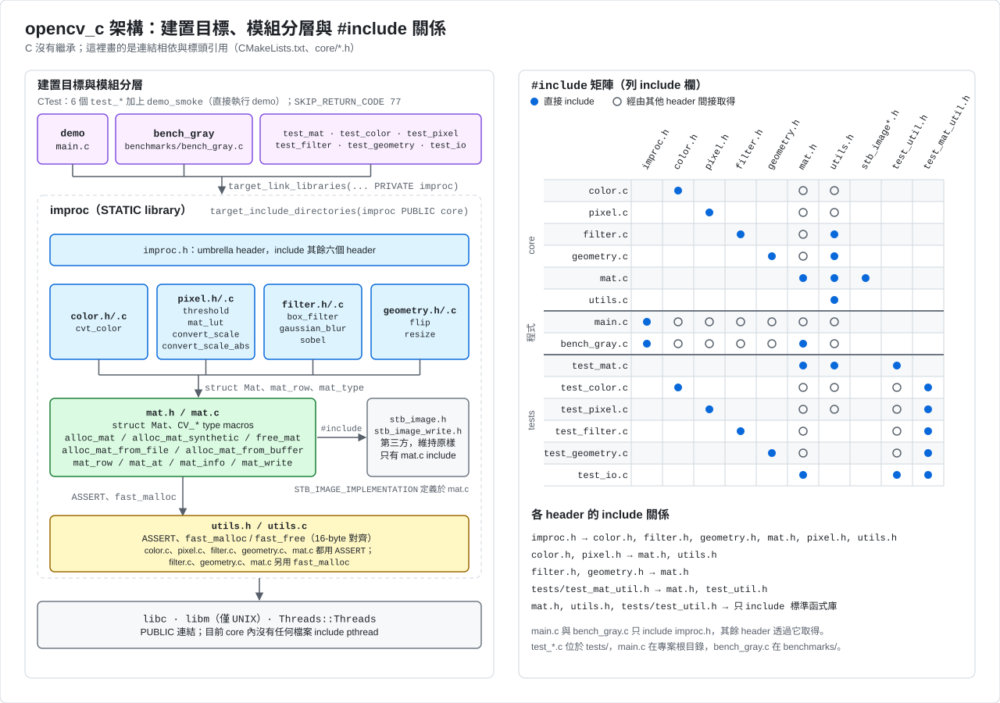
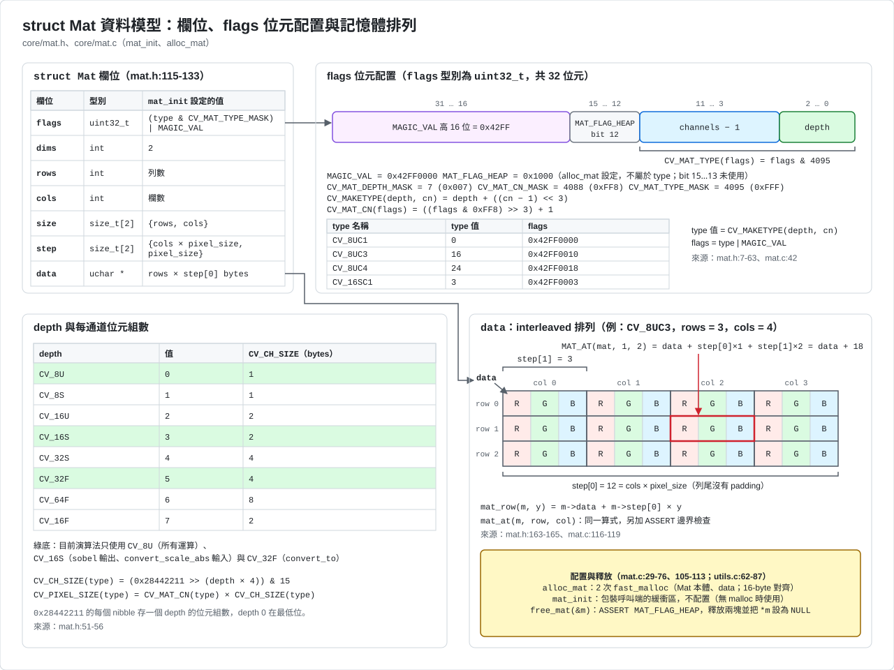
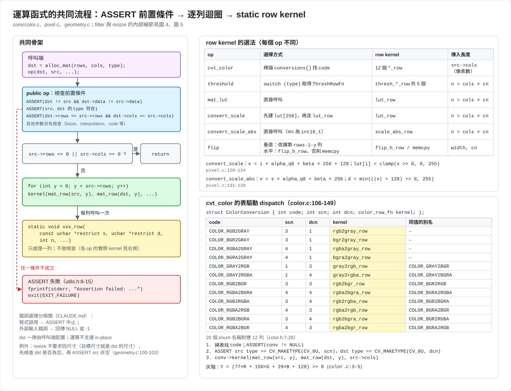
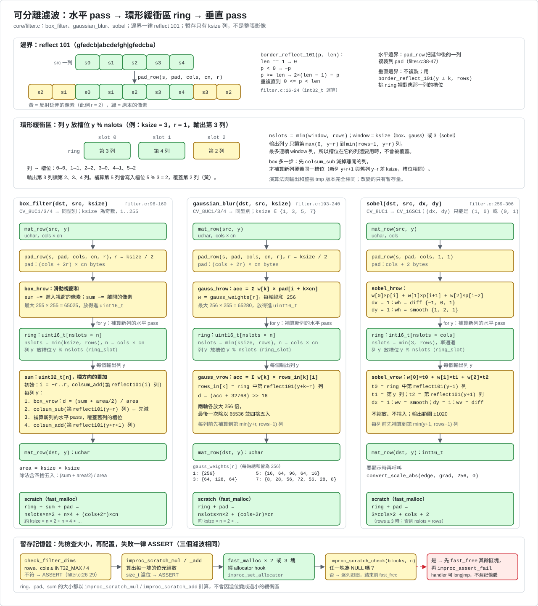
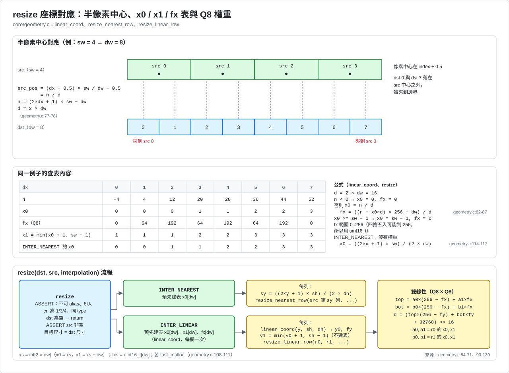
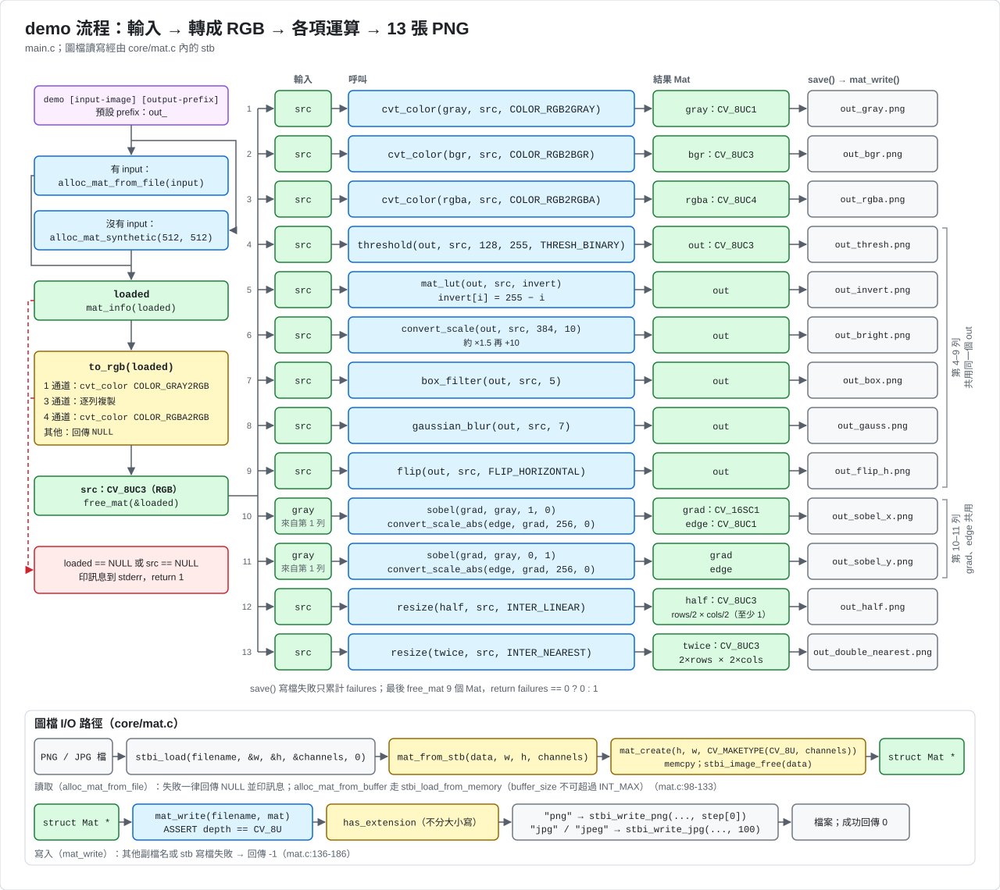

# 程式架構圖

這些圖對應目前的 scalar 版本（包含 phase 2 新增的運算）。C 沒有繼承，所以「關係圖」畫的是連結相依、`#include` 關係與 `struct Mat` 的資料模型，而不是類別階層。

標示慣例：識別字、型別、算式照程式碼用英文；說明文字用繁體中文。

| 顏色 | 意義 |
|---|---|
| 藍 | 公開 API |
| 綠 | 資料（`Mat`、緩衝區、表） |
| 黃 | 內部 `static` 函式與輔助程式 |
| 紫 | 執行檔、CMake 目標、呼叫端 |
| 灰 | 第三方或系統（stb、libc、檔案） |
| 紅 | `ASSERT` 與錯誤路徑 |

## 1. 模組與建置目標

左半部是 CMake 目標。`improc_core` 靜態函式庫是可攜核心：七個運算模組（color、pixel、filter、morph、hist、geometry、convert_f32）加上 `mat` 與 `utils`，不含 stdio、pthread 與檔案 IO。`improc` 靜態函式庫在它之上加 `mat_io.c`（圖檔讀寫，只有這個檔案 include 第三方的 stb），並連結 Threads。`demo`、`bench_gray`、測試與 Kodak 測試都連結 `improc`。`improc.h` 是 umbrella header，負責 include 其餘 header；`improc_internal.h` 只給核心與測試使用，不在 umbrella 內。右半部列出各檔案 `#include` 的 header。

對應檔案：`CMakeLists.txt`、`core/improc.h`、`core/improc_internal.h`。

## 2. struct Mat 資料模型

`flags` 是 `uint32_t`，由幾個欄位組成：高 16 位是魔術數字 `MAGIC_VAL`，位元 12 是 `MAT_FLAG_HEAP`（`alloc_mat` 設定，表示資料由 Mat 擁有），位元 11..3 存「通道數減 1」，位元 2..0 存 depth；低 12 位合起來就是 type。`dims` 是 `int`，`size[2]` 與 `step[2]` 直接放在標頭內。`step[0]` 是一列的位元組數，`step[1]` 是一個像素的位元組數；資料是 interleaved 排列，列尾沒有 padding，所以 `mat_row` 與 `mat_at` 都用同一條位址算式。`alloc_mat` 用 16-byte 對齊的 `fast_malloc` 配置兩塊（標頭與資料），`free_mat` 檢查 `MAT_FLAG_HEAP` 後一次釋放。`mat_init` 則在呼叫端的緩衝區上建立標頭，完全不配置記憶體，沒有 malloc 的目標用它。

對應檔案：`core/mat.h`、`core/mat.c`、`core/utils.c`。

## 3. 運算函式的共同流程

呼叫端先配置 `dst`，運算函式再用 `ASSERT` 檢查前置條件。`ASSERT` 失敗時呼叫 `improc_assert_fail`：如果用 `improc_set_assert_handler` 裝了 handler，就先呼叫它（handler 可以 `longjmp` 回到呼叫端）；handler 沒有接手時，才印訊息並 `exit(EXIT_FAILURE)`，定義 `IMPROC_NO_STDIO` 時改成 `abort()`。需要暫存記憶體的運算（filter、morph、resize、hist）用 `improc_scratch_mul` / `improc_scratch_add` 檢查大小，再用 `fast_malloc`（可用 `improc_set_allocator` 換掉配置器）配置，最後由 `improc_scratch_check` 檢查：只要有一塊是 `NULL`，就先釋放其餘區塊再 `ASSERT`，所以 handler 用 `longjmp` 也不會漏記憶體。通過檢查後逐列呼叫帶有 `restrict` 的 `static` row kernel，每個 kernel 只處理一列、不做檢查。`cvt_color` 用一張 20 列的轉換表挑 kernel（含 HSV 與 YUV），其他運算各自選擇 kernel 的方式見圖中表格。

對應檔案：`core/color.c`、`core/pixel.c`、`core/geometry.c`、`core/utils.h`、`core/utils.c`、`core/improc_internal.h`。`morph`、`hist`、`convert_f32` 的前置條件寫法與此相同。

## 4. 可分離濾波

`box_filter`、`gaussian_blur`、`sobel` 都分成水平與垂直兩個 pass，中間用環形緩衝區 `ring` 銜接，而不是整張暫存影像。`ring` 只有 `nslots = min(視窗列數, rows)` 列（`box`、`gauss` 的視窗是 `ksize`，`sobel` 是 3），列 `y` 放在槽位 `y % nslots`。輸出列 `y` 最多讀連續 `window` 列，所以槽位在它的列還要用的時候不會被覆蓋。`box_filter` 另外保留一條 `uint32_t` 的欄累加 `sum`，並且在補算新列（會覆蓋同一個槽位）之前，先把離開的那一列減掉。三者的 `ring` 型別、捨入方式各不相同，邊界一律使用 reflect 101。圖中並排列出三條流程，並標出各自的暫存大小（`box`：`ksize*n*2 + n*4 + (cols+2r)*cn`；`gauss`：`ksize*n*2 + (cols+2r)*cn`；`sobel`：`3*cols*2 + cols + 2`，單位是位元組），最下方畫出大小檢查與 `improc_scratch_check` 的失敗路徑。更完整的暫存量見 [porting.md](porting.md)。

對應檔案：`core/filter.c`、`core/improc_internal.h`。

## 5. resize 座標對應

`resize` 支援 `INTER_NEAREST`、`INTER_LINEAR` 與 `INTER_AREA`。前兩者使用半像素中心的座標對應公式，只有 x 方向預先建表，因為每一列都會重複用到同一組 x 座標；y 方向每列只算一次。雙線性內插的權重是 Q8 定點數，最後一次右移 16 位並四捨五入。`INTER_AREA` 是另一條路徑（`resize_area`）：每個目的像素取它所蓋住的來源面積的平均，權重是來源與目的區間的整數重疊長度（例：4 個像素縮成 3 個，權重為 `[3,1,0,0]`、`[0,2,2,0]`、`[0,0,1,3]`），結果是 `(acc + den/2) / den`，`den = 來源寬 × 來源高`，全程整數運算。它要求來源像素數不超過 2^24，並用 `2 × dw × cn × 4` 位元組的暫存。圖中最下方的面板畫出這個例子。

對應檔案：`core/geometry.c`。

對應檔案：`core/geometry.c`。

## 6. demo 流程與圖檔 I/O

`demo` 讀入圖檔（或用 `core/mat.c` 的 `alloc_mat_synthetic` 產生合成圖）、轉成 RGB，再依序做運算並各存成一張 PNG。圖中依 `main.c` 的順序列出全部 24 項運算（gray、bgr、rgba、thresh、invert、bright、box、gauss、flip_h、sobel_x、sobel_y、half、double_nearest、erode、dilate、equalize、otsu、open、close、hsv、hsv_roundtrip、yuv、yuv_roundtrip、half_area）；第 25 項 `f32_roundtrip`（`CV_32F` 來回轉換）只在 `IMPROC_HAS_FLOAT` 為真時才執行，所以輸出是 24 張，有浮點時 25 張。部分 `Mat`（`out`、`half`、`conv`、`mor`、`grad`、`edge`）會重複使用。圖檔讀寫在 `core/mat_io.c`（`improc` 函式庫，只有它 include stb）；Mat 本身與合成圖在 `improc_core`。失敗時回傳 `NULL` 或 `-1`，`demo` 只累計失敗次數。

對應檔案：`main.c`、`core/mat_io.c`、`core/mat.c`。

## 維護方式

SVG 為手寫。程式改動時，要一併更新下列圖：

| 改動 | 要更新的圖 |
|---|---|
| 改 `flags` 或 type 巨集 | 圖 2 |
| 新增運算函式或模組 | 圖 1、3、6 |
| 改濾波演算法或暫存大小 | 圖 4 |
| 改 `resize`（含 `INTER_AREA`） | 圖 5 |
| 改 `ASSERT` 或暫存記憶體政策 | 圖 3、4 |
